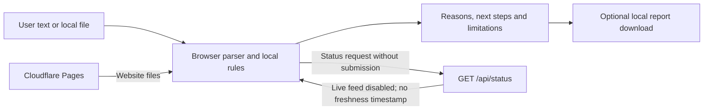

# What CheckFirst does with information

<strong>Local analysis, explicit uncertainty.</strong> The prototype derives observations in the browser. The included server route reports source availability; it does not evaluate submitted messages or links.

This is a description of the supplied implementation, not a claim that hosting providers see no traffic or that every possible input is understood. Read [SETUP.md](SETUP.md) for service disclosures and [VERIFICATION.md](VERIFICATION.md) for what was actually tested.

## Data paths

No arrow connects submitted content to a feed, database or analysis server. The browser still contacts the hosting service to obtain the app and may request its source-status endpoint. Ordinary network metadata is visible to that hosting service. Browser extensions, a managed device, the operating system, downloaded files and the original mail application are outside this application's storage controls.

| Information | Where it goes in this version | Retention / control |
|---|---|---|
| Pasted message or link | Browser memory for parsing and displayed observations | Not saved as a server record; close/reload the page to discard the app's transient state |
| Selected `.eml` file | Read by the browser's MIME parser | Original stays on your device; not uploaded or deleted by the app |
| QR image / decoded text | Browser decoding and local analysis | No camera stream or external decoding service required |
| Phone number / description | Browser number-format parser and text rules | No reverse lookup or phone-reputation provider request |
| Optional report | Generated locally and downloaded to your device | Owner chooses where to store/share/delete it |
| `/api/status` request | Same-origin Pages Function when available | Contains no submission payload; Cloudflare may record normal request metadata |
| Git repository and build logs | GitHub and Cloudflare after owner connection | Provider account controls apply; do not commit submissions or secrets |

The source-status request occurs when someone selects **Check service availability**, not as a submission lookup. The project does not implement user accounts, a submissions database, cloud report storage or live threat-feed retrieval. No Supabase project is needed. Source delivery and local-memory processing still depend on the integrity of the browser and deployed application; this is not a forensic isolation environment.

## Implemented analysis and its boundaries

| Capability | Actual operation | What is not established |
|---|---|---|
| Message observations | Simple English patterns for pressure, secrets, money, device access and isolation | Sender intent, comprehensive language understanding or detection accuracy |
| Link structure | Standard URL parsing and registered-domain extraction; selected structural/context checks | Destination content, redirects, domain age, ownership, TLS validity or reputation |
| Email file | MIME parsing, readable text extraction, first Reply-To comparison, attachment count | SPF/DKIM/DMARC verification, attachment safety, accurate rendering or complete MIME coverage |
| Phone interaction | Country-aware number-length/format checks plus description patterns | Caller identity, ownership, geolocation, call authenticity or call-audio analysis |
| QR | Local image decoding / decoded-text analysis | Every code in an image, hidden non-QR content, legitimacy or safety of its action |
| Report | Markdown containing findings and explicit limits; redacted by default | Automatic removal of every potential indirect identifier from a human's future edits |
| Source status | `GET /api/status` reports `onlineChecks: "disabled"`, `source: "OpenPhish"`, `lastUpdated: null`, `acceptsSubmissions: false` | A live feed connection, retrieved dataset, provider freshness or a match verdict |

The response also identifies `service: "checkfirst"`, `version: "0.1.0"` and the reason the feed is disabled. This metadata describes the app; it does not prove a phishing lookup happened. The endpoint returns JSON and `Cache-Control: no-store`. It is not a submissions API.

## Parsing and resource limits

Text analysis checks at most **50,000 characters**. URL extraction retains at most **100 distinct links**; extraction focuses on HTTP/HTTPS and `www.` patterns, while a directly entered link can be parsed separately. An app-specific URI or a deliberately obfuscated address may not be treated as a normal web link. Limits are disclosed instead of implying the complete input was checked.

Email files are limited to **2 MiB (2,097,152 bytes)** and MIME nesting depth **20**. `postal-mime` extracts available content. Empty or unreadable emails are rejected. HTML content is processed as a string, with tags removed and selected quoted `href`/`src` attributes extracted for local analysis. HTML is **not inserted into the page or rendered**. This deliberately incomplete conversion can miss encoded, malformed, unquoted or otherwise obfuscated content. Script/style text is removed during conversion; no script from the email is executed.

Encrypted content is not decrypted. Attachments may be recognised by the parser but are not executed, opened or scanned. Only the first parsed Reply-To address is compared with From. A mismatch can be legitimate, and matching addresses are not proof of authenticity. `.msg`, mailbox archives and audio files are outside the supported email workflow.

The number parser checks plausibility, not reputation. A country selector provides context for national numbers; international/shared calling codes do not establish a user's physical location. The interface collects a number (up to 60 characters) and optional description in separate fields; internally, the first line passed to the analysis function is the number.

QR decoding does not navigate. The interface accepts PNG, JPEG and WebP images up to **5 MiB (5,242,880 bytes)** and **16,000,000 pixels**. It uses a temporary local object URL, draws pixels into a canvas and runs `jsQR`; the object URL is revoked afterwards. It reads one detected QR code, not every code in a document. A browser image-decoding failure, unsupported format, oversize image or missing code produces an error instead of a safety result. No live malicious destination is needed to test this path.

## Reports and redaction

`createReport` in `src/analyze.ts` excludes raw submissions, email metadata, phone numbers and destination domains by default. It includes a timestamp, mode, generic observations and the declared missing checks. Opting into destination details includes domains with dots replaced by `[.]`, and a parsed phone number if present. The original message and full URL parameters are not added by this report function.

A report can still reveal context through the selected finding categories and timestamp. Review it before sharing, and do not append private evidence to a public issue. The app does not manage retention or deletion of reports after download.

## Optional external intelligence

OpenPhish is evaluated and disabled; there is no implemented live adapter, cache, scheduled refresh or enable key. [SETUP.md](SETUP.md#5-optional-phishing-feed-evaluated-and-disabled) records the dated official-source review and why permission for this use is not established. No live phishing dataset is committed.

There is no live source freshness to display. A source-status response with `lastUpdated: null` means no data was retrieved, not that data is fresh. A network failure, missing endpoint or malformed response must remain unavailable. Controlled tests for such states provide UI evidence only; they cannot prove provider uptime or licence compliance.

Any future integration needs a reviewed privacy contract and permission for the intended use. It must disclose exactly what is sent, retain independent local operation, share permitted feed refreshes across submissions, handle failures and stale timestamps explicitly, and distinguish **not listed** from **safe**. These are future acceptance requirements, not delivered claims.

## Maintaining the organization directory

The **Reviewed support directory · Australia** disclosure in the help section is backed by `src/directory.ts`. It contains three independently reviewed public support links. It is not an allowlist and is not used to classify submitted domains. A familiar organization can be impersonated, and an authentic-looking URL inside a message is not a reason to click it.

| Entry | Purpose | Official source reviewed | Review date |
|---|---|---|---|
| Scamwatch | Scam reporting in Australia | [Scamwatch reporting page](https://www.scamwatch.gov.au/report-a-scam) | 2026-09-27 |
| ReportCyber | Cybercrime / incident reporting in Australia | [Cyber.gov.au reporting page](https://www.cyber.gov.au/report-and-recover/report) | 2026-09-27 |
| IDCARE | Identity and cyber support | [IDCARE official website](https://www.idcare.org/) | 2026-09-27 |

These are website-source reviews, not test reports submitted to the services, partnerships or endorsements. Opening a support link is a deliberate external navigation: that provider receives a normal visit and any information the person subsequently chooses to provide. CheckFirst does not automatically file a report or send its analysed content.

For each entry in `src/directory.ts`, maintain its name, purpose, official URL and actual `reviewed` date, keeping the geographic scope clear in the displayed section. Open the organization's official website independently and verify that the contact/help path is current; do not derive entries from a submitted message. Update the entry only after the check and keep the displayed review date in `src/main.ts` synchronized, then rerun the app checks and review the displayed link. Remove or clearly mark entries when verification is no longer possible. Do not add private phone books, personal contact details or unverified accusations.

Never advance every review date merely because a build was run. A source review date is distinct from a release date or the timestamp of a user's analysis. Directory contents and the exact implementation file must be checked whenever this document is updated.

## Security and accessibility evidence

Untrusted content must be escaped when displayed, suspicious destinations must remain non-clickable, and email resource references must not become browser network loads. The Pages `_headers` and `_routes.json` files complement these design decisions. Server status responses apply their own response headers; static-header rules alone are not evidence that Functions have those headers.

Keyboard operation, readable zoom, mobile layouts, privacy-network behaviour and unavailable-source handling belong in the test record. Do not label the tool accessibility-certified or production-secure because a small automated suite passed. The university prototype should be evaluated with its intended users before wider adoption.

## Scope changes that require a new review

Revisit these documents before adding an account system, analytics, telemetry, remote URL expansion, email uploads, AI APIs, feedback forms, saved reports, live feeds or a database. Such additions change where information goes and may change costs and permissions. Keep the setup variable inventory, user-facing privacy wording, tests and presentation synchronized with the actual implementation.
